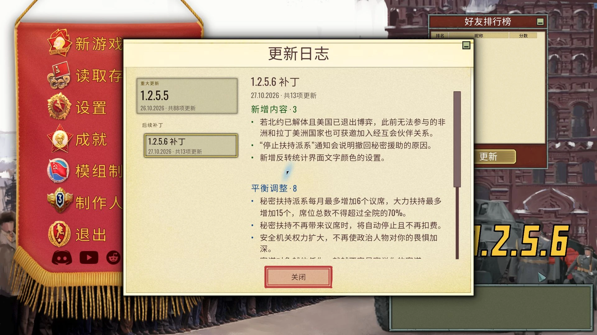

# 《克里姆林宫危机：冷战》简体中文补丁

适用于 Windows 版 Steam 构建 **26243566**。本项目独立提供这款游戏的中文文本校订、字体补丁和安装器。[下载 Windows 版](https://github.com/lingjieheti/crisis-in-the-kremlin-cold-war-zh-cn/releases/latest) · [本次文本校对报告](games/coldwar/AUDIT.md)

本次修正了错位的阿尔及利亚内战结局、进口上限和议会席位说明。遇到英俄原文相互矛盾的决议提示，按当前 Steam 构建的实际计算逻辑核对。

## 安装与更新

1. 在 Steam 安装游戏，登录拥有该游戏的账号，然后退出游戏。
2. 安装 Windows **64 位 Python 3.12**，下载 Release 中以 `-Windows.zip` 结尾的文件并完整解压。[Python 官方下载](https://www.python.org/downloads/windows/)
3. 双击 **汉化管理.cmd**，选择 **安装或更新**。完成后从 Steam 启动游戏。再次打开管理器，可以核验已安装的文件或还原。

安装器通过 Steam 获取社区中文底包，并启用本地校订版。同一时间请只启用一款翻译模组。

高级用法、备份位置、上游译者署名与字体授权见[安装与来源说明](games/coldwar/README.md)。也可在解压目录打开终端运行：

```powershell
py -3.12 manage.py install
py -3.12 manage.py verify
py -3.12 manage.py restore
```

## 实机画面

下图记录 Windows 实机检查的更新日志。文本校对的范围、此次修订及仍待验证的内容见[校对报告](games/coldwar/AUDIT.md)。


